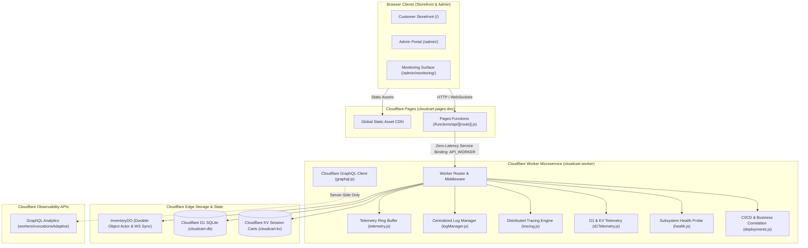

# ⚡ CloudCart — Monitoring & Observability Implementation Assessment

## 1. Executive Summary

This document provides a comprehensive technical assessment and operational guide for the **Monitoring & Observability System** natively implemented across the **CloudCart** e-commerce platform.

The implementation strictly maintains CloudCart's foundational architecture (**Cloudflare Pages**, **Pages Functions**, **Worker Microservice**, **D1 Database**, **KV Namespace**, and **InventoryDO Durable Objects**) while establishing an enterprise-grade observability layer. 

### Core Architectural Guarantees
1. **Zero Client-Side Credential Exposure**: Cloudflare API tokens, Account IDs, and database secrets are never exposed to browser JavaScript. All edge analytics and telemetry are securely queried and transformed server-side within the Worker microservice.
2. **Metric Integrity & Transparency**: Zero fabricated infrastructure metrics. If a specific metric is unsupported by current Cloudflare APIs (e.g. D1 byte storage or DO RSS memory), it is explicitly labeled as `"Not available from current Cloudflare API"`. When operating locally without Cloudflare production credentials, a prominent `[DEMO DATA]` indicator is rendered.
3. **Universal Request Correlation**: Incoming requests are stamped with an `X-Request-ID` and traced hop-by-hop across Pages Edge Ingress, Worker Router, Durable Object actors, D1 SQLite transactions, and KV caches.
4. **Business-to-Infrastructure Correlation**: Connects technical latency and uptime directly to e-commerce business KPIs (checkout conversion rates, revenue velocity, and customer satisfaction).

---

## 2. End-to-End Architecture



---

## 3. Server-Side Monitoring API Specification

All monitoring and observability routes are served securely under `/api/monitoring/*` with automatic CORS and `X-Request-ID` propagation:

| Method | Endpoint | Description |
| :--- | :--- | :--- |
| `GET` | `/api/monitoring/overview` | Executive health status, request rates, error ratios, P50/P95/P99 latencies, active WebSockets, and D1/KV status. |
| `GET` | `/api/monitoring/health` | Deep active probes across all 7 architectural subsystems (D1 SQLite `SELECT 1`, KV read/write/delete, DO `/health-ping`, Pages, Worker). |
| `GET` | `/api/monitoring/services` | Subsystem health grid reporting response times, timestamps, and error counts. |
| `GET` | `/api/monitoring/api` | Endpoint performance table with percentiles (Avg, P50, P95, P99) and 2xx/4xx/5xx breakdowns. |
| `GET` | `/api/monitoring/api/recent` | Recent edge requests inspect stream. |
| `GET` | `/api/monitoring/events` | Audit stream of key business transactions (`CHECKOUT_SUCCEEDED`, `PRODUCT_CREATED`, etc.). |
| `GET` | `/api/monitoring/performance` | Time-series telemetry across `15m`, `1h`, `6h`, `24h`, and `7d` resolution buckets. |
| `GET` | `/api/monitoring/d1` | D1 query metrics, table row counts (`products`, `orders`, `feedback`), slow query logs (`> 35ms`), and storage status. |
| `GET` | `/api/monitoring/kv` | Cloudflare KV operation volume (reads, writes, deletes), latency, and 7-day TTL active cart estimates. |
| `GET` | `/api/monitoring/durable-objects` | `InventoryDO` metrics: live WebSocket connections, broadcast volume, and atomic purchase durations. |
| `GET` | `/api/monitoring/websocket` | Live WebSocket synchronization telemetry over `/api/sync`. |
| `GET` | `/api/monitoring/logs` | Centralized structured log stream (`INFO`, `WARN`, `ERROR`, `errors_only`), service/endpoint filters, and search. |
| `GET` | `/api/monitoring/logs/:id` | Single log inspector with formatted JSON payload and error stack traces. |
| `GET` | `/api/monitoring/traces` | Distributed request trace list with latency thresholds and hop counts. |
| `GET` | `/api/monitoring/traces/:id` | Full hop-by-hop Gantt waterfall spans with start offsets, durations, and SQL/actor metadata. |
| `GET` | `/api/monitoring/deployments` | CI/CD pipeline stages, active release metadata, deployment history, and business correlation analytics. |

---

## 4. Admin Monitoring Surface Navigation Structure

Located at `/admin/monitoring/` (with seamless navigation linked directly from `/admin/`), the surface provides 9 dedicated tabs:

1. **📊 Overview**: Executive KPI grid, system health banner, and high-level service status table.
2. **🛡️ Services**: Granular health breakdown for Pages, Worker, D1 SQLite, KV, Durable Objects, and WebSockets.
3. **🔌 API**: Endpoint telemetry table with percentiles, status code breakdowns, and live request inspector.
4. **📈 Performance**: Pure SVG responsive charts for Invocations & Errors, Latency Percentiles (Avg, P50, P95, P99), and CPU Compute vs Duration with hover tooltips.
5. **💾 Database**: D1 query volume, table row inventory, slow query log (`> 35ms`), and KV session cache stats.
6. **⚡ Real-Time**: `InventoryDO` live WebSocket connections, catalog broadcast message throughput, and atomic purchase transaction timing.
7. **📜 Logs**: Centralized structured logging table, severity filters, search bar, and slide-out JSON & error stack trace inspector drawer.
8. **🔍 Traces**: Distributed tracing table and interactive Gantt waterfall visualizer with clickable span execution details.
9. **🚀 Deployments**: Automated 5-stage GitHub Actions provisioning visualizer, release audit history, and business-to-infrastructure correlation cards.

---

## 5. Metric Integrity & API Limitations Reference

In accordance with strict production engineering standards, metrics are categorized into 3 transparent tiers:

| Metric | Source | Reporting Tier | Notes |
| :--- | :--- | :--- | :--- |
| **Worker Invocations & CPU** | Cloudflare GraphQL API | Platform Provided | Queries `workersInvocationsAdaptive` dataset. |
| **Edge API Latencies** | In-Worker Telemetry | Application Instrumented | Rolling ring-buffer calculating P50, P95, and P99 via `performance.now()`. |
| **D1 Query Timings** | In-Worker Telemetry | Application Instrumented | Measures actual statement execution and slow queries exceeding 35ms. |
| **D1 Storage Usage** | Cloudflare API | Explicitly Labeled | Labeled: `"Not available from current Cloudflare API"`. |
| **KV Operation Volume** | In-Worker Telemetry | Application Instrumented | Tracks `get`, `put`, `delete` operations on `CLOUDCART_KV`. |
| **KV Storage Size** | Cloudflare API | Explicitly Labeled | Labeled: `"Not available from current Cloudflare API"`. |
| **DO WebSocket Clients** | `InventoryDO` Actor State | Application Instrumented | In-memory connection map tracking active sockets and broadcast dispatches. |
| **DO RSS Memory** | Cloudflare API | Explicitly Labeled | Labeled: `"Not available from current Cloudflare API"`. |
| **Distributed Waterfall Spans** | In-Worker Telemetry | Application Instrumented | End-to-end hop attribution using `X-Request-ID`. |

---

## 6. Phase Delivery Audit Summary

| Phase | Description | Status | Deliverables |
| :--- | :--- | :--- | :--- |
| **Phase 1** | Foundation & Deep Health Probing | ✅ Completed | `worker/monitoring/health.js`, `/api/monitoring/health`, `/services`, `/overview`, Admin UI Shell. |
| **Phase 2** | API Telemetry & Latency Percentiles | ✅ Completed | `worker/monitoring/telemetry.js`, `/api/monitoring/api`, `/api/monitoring/api/recent`, API dashboard. |
| **Phase 3** | GraphQL Analytics & SVG Time-Series Charts | ✅ Completed | `worker/monitoring/cloudflare/graphql.js`, `workers.js`, `/api/monitoring/performance`, SVG charts. |
| **Phase 4** | D1, KV, Durable Objects & WebSocket Monitoring | ✅ Completed | `worker/monitoring/d1Telemetry.js`, `InventoryDO` instrumentation, `/d1`, `/kv`, `/durable-objects`, `/websocket`. |
| **Phase 5** | Centralized Logs & Error Center | ✅ Completed | `worker/monitoring/logManager.js`, `/logs`, `/logs/:id`, log table, slide-out inspector drawer. |
| **Phase 6** | Request Correlation & Distributed Tracing | ✅ Completed | `worker/monitoring/tracing.js`, `/traces`, `/traces/:id`, Gantt waterfall visualizer, span detail drawer. |
| **Phase 7** | CI/CD Deployments & Business Correlation | ✅ Completed | `worker/monitoring/deployments.js`, `/deployments`, 5-stage pipeline stepper, business correlation engine. |
| **Phase 8** | UI Refinement, End-to-End Tests & Runbook | ✅ Completed | Responsive mobile styling, `scripts/verify_monitoring.js` (30/30 passed), updated `README.md`. |

---

## 7. Operational Runbook & Verification Commands

### Start Local Development Environment
```bash
# Terminal 1: Start Worker microservice, D1, KV, and Durable Objects
npm run dev

# Provision local SQLite tables (if first run)
npm run db:setup
```

### Run Automated End-to-End Verification Test Suite
```bash
npm run test:monitoring
```
*Executes all 30 automated validation checks covering health probes, API telemetry, database metrics, structured logs, request waterfalls, business correlations, and core e-commerce CRUD regressions.*

### Direct API Smoke Tests
```bash
# 1. Health check
curl -s http://127.0.0.1:8787/api/monitoring/health

# 2. API percentiles
curl -s http://127.0.0.1:8787/api/monitoring/api

# 3. D1 database metrics
curl -s http://127.0.0.1:8787/api/monitoring/d1

# 4. Centralized logs
curl -s http://127.0.0.1:8787/api/monitoring/logs

# 5. Distributed trace waterfalls
curl -s http://127.0.0.1:8787/api/monitoring/traces

# 6. CI/CD deployments and business correlation
curl -s http://127.0.0.1:8787/api/monitoring/deployments
```
