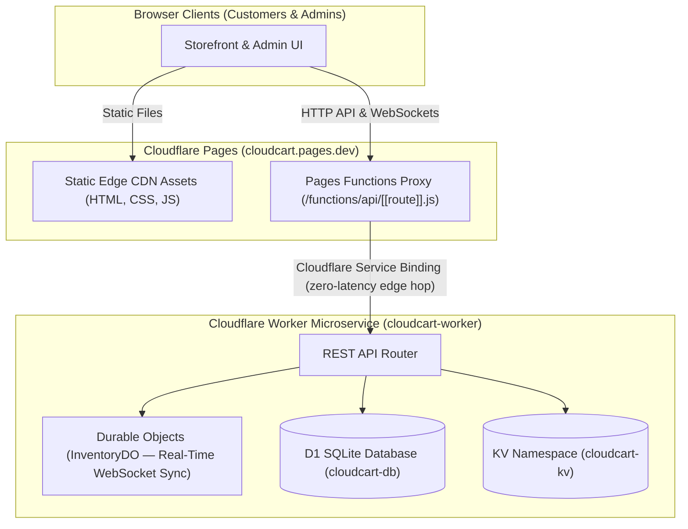

# CloudCart — Cloudflare-Native E-Commerce Platform

A production-grade, full-stack e-commerce platform built with **HTML, CSS, and JavaScript**, architected natively on the **Cloudflare Developer Platform** using **Pages + Workers + Service Bindings + D1 + KV + Durable Objects**.

---

## Architecture



| Cloudflare Service | Role in CloudCart |
| :--- | :--- |
| **Cloudflare Pages** | Global CDN hosting for the storefront & admin UI at `cloudcart.pages.dev`. |
| **Pages Functions** | Serverless edge proxy intercepting all `/api/*` requests from the browser. |
| **Service Bindings** | Zero-latency, zero-network-hop Worker-to-Worker call from Pages → backend Worker. |
| **Cloudflare Worker** | Backend microservice (`cloudcart-worker`) — REST API, checkout, inventory management. |
| **Cloudflare D1** | Serverless SQLite database (`cloudcart-db`) for products, orders, and feedback. |
| **Durable Objects** | `InventoryDO` — atomic stock transactions & real-time WebSocket broadcast to all clients. |
| **Cloudflare KV** | `cloudcart-kv` — persistent shopping cart session cache, 7-day TTL per session. |
| **GitHub Actions** | One-command CI/CD pipeline: provisions all Cloudflare resources and deploys on push to `main`. |

---

## Features

### Customer Storefront (`/`)
- Dark-mode tech storefront with responsive product grid, live search, and category filters.
- Product catalog loaded from D1 with ₹ (Indian Rupee) pricing.
- **Real-time stock badges** (`In Stock` / `Only X Left!` / `Out of Stock`) pushed via WebSocket — no page refresh needed.
- Slide-in cart drawer with quantity controls, persisted to Cloudflare KV across sessions.
- Customer feedback modal with 1–5 star rating.

### Admin Portal (`/admin/`)
- Live dashboard metrics: Active Products, Total Inventory, Connected Users, Total Revenue.
- Inline product price editor, stock adjust (`+`/`-`), and soft-delete.
- **Add Product** modal — inserts directly into D1 and broadcasts to all live clients.
- Recent orders table and customer reviews panel, updated in real time.

### Observability Dashboard (`/admin/observability/`)
- Queries Cloudflare Workers Observability for live logs, metrics, and traces.
- Health check probes: D1 `SELECT 1`, KV read, and Durable Object ping.
- No historical telemetry store — Cloudflare retains data per its standard retention policy.

---

## Deployment Guide (GitHub + Cloudflare)

### Prerequisites

1. **A Cloudflare account** — [Sign up free](https://dash.cloudflare.com/sign-up).
2. **A GitHub account** — to push this repository.

---

### Step 1 — Create a Cloudflare API Token

1. Go to [Cloudflare Dashboard → My Profile → API Tokens](https://dash.cloudflare.com/profile/api-tokens).
2. Click **Create Token** → **Create Custom Token**.
3. Give it a name, e.g. `cloudcart-deploy`.
4. Under **Permissions**, add **all** of the following rows:

   | Resource Type | Resource | Permission |
   | :--- | :--- | :--- |
   | Account | Workers Scripts | Edit |
   | Account | Workers KV Storage | Edit |
   | Account | Workers Durable Objects | Edit |
   | Account | Cloudflare Pages | Edit |
   | Account | D1 | Edit |
   | Account | Workers Observability | Edit |
   | Account | Account Analytics | Read |
   | Zone | Workers Routes (all zones) | Edit |

5. Under **Account Resources**, select **Include — \<Your Account Name\>**.
6. Click **Continue to Summary** → **Create Token**.
7. **Copy the token immediately** — it is only shown once.

---

### Step 2 — Find Your Cloudflare Account ID

1. Log in to the [Cloudflare Dashboard](https://dash.cloudflare.com).
2. From the **Home** page (or any zone's Overview page), look in the **right sidebar**.
3. Copy the **Account ID** (32-character hex string).

---

### Step 3 — Push This Repository to GitHub

```bash
git clone https://github.com/<your-username>/cloudcart.git
cd cloudcart
# Or if you already have the files locally:
git remote add origin https://github.com/<your-username>/cloudcart.git
git push -u origin main
```

---

### Step 4 — Add GitHub Actions Secrets

1. In your GitHub repository, navigate to **Settings → Secrets and variables → Actions**.
2. Click **New repository secret** and add **both** of the following:

   | Secret Name | Value |
   | :--- | :--- |
   | `CLOUDFLARE_API_TOKEN` | The API token you created in Step 1. |
   | `CLOUDFLARE_ACCOUNT_ID` | Your Account ID from Step 2. |

   That's it — **only 2 secrets are needed.** Everything else is derived automatically by the deployment script.

---

### Step 5 — Trigger the Deployment

**Option A — Automatic (recommended):** Push any commit to `main`. GitHub Actions runs `.github/workflows/deploy.yml` automatically.

**Option B — Manual trigger:** Go to **Actions → Provision & Deploy CloudCart to Cloudflare → Run workflow** → **Run workflow**.

#### What the pipeline does:
1. Installs Node dependencies (`npm ci`).
2. Runs `scripts/setup.js`, which:
   - **Creates or reuses** a D1 database named `cloudcart-db`.
   - **Creates or reuses** a KV namespace named `cloudcart-kv`.
   - **Generates** `wrangler.toml` with the real resource IDs.
   - **Applies** the DB schema (`schema.sql`) and seeds the initial catalog (`initial_catalog.sql`) — safe to re-run, uses `CREATE TABLE IF NOT EXISTS` and `INSERT OR IGNORE`.
   - **Deploys** the backend Worker (`cloudcart-worker`).
   - **Configures** the Cloudflare Pages project (`cloudcart`) with the `API_WORKER` Service Binding.
   - **Deploys** the frontend to Cloudflare Pages.

---

### Step 6 — Verify the Deployment

After the workflow completes, open these URLs:

| URL | What you see |
| :--- | :--- |
| `https://cloudcart.pages.dev` | Customer storefront with live product catalog |
| `https://cloudcart.pages.dev/admin/` | Admin portal with live metrics & inventory |
| `https://cloudcart.pages.dev/admin/observability/` | Cloudflare-native observability dashboard |

---

## 📁 Repository Structure

```
cloudcart/
├── .github/
│   └── workflows/
│       └── deploy.yml                  # GitHub Actions CI/CD pipeline
├── functions/
│   └── api/
│       └── [[route]].js                # Pages Functions — API proxy to backend Worker
├── migrations/
│   └── 0001_initial_schema.sql         # Durable Object SQL migration record
├── public/                             # Frontend static assets (served by Cloudflare Pages)
│   ├── index.html                      # Customer storefront
│   ├── _redirects                      # Cloudflare Pages redirect rules
│   ├── css/styles.css                  # Global styles
│   ├── js/
│   │   ├── app.js                      # Storefront app (products, cart, WebSocket)
│   │   └── api.js                      # API client helpers
│   └── admin/
│       ├── index.html                  # Admin portal
│       ├── css/admin.css
│       ├── js/admin.js
│       └── observability/
│           ├── index.html              # Observability dashboard
│           ├── css/observability.css
│           └── js/observability.js
├── scripts/
│   ├── setup.js                        # Cloudflare provisioning & deployment script
│   └── verify_observability.js         # API endpoint verification suite
├── worker/                             # Cloudflare Worker backend
│   ├── index.js                        # REST API router & request handler
│   ├── InventoryDO.js                  # Durable Object: atomic checkout + WebSocket sync
│   └── observability/
│       └── routes.js                   # Observability API route handlers
├── initial_catalog.sql                 # Seed data — uses INSERT OR IGNORE (never overwrites)
├── schema.sql                          # D1 schema — uses CREATE TABLE IF NOT EXISTS
├── wrangler.toml                       # Wrangler config (auto-regenerated by scripts/setup.js)
└── package.json
```

---

## 🗄️ Database Schema

Three tables in Cloudflare D1 (`cloudcart-db`):

```sql
products  (id, name, category, price, stock, description, image_url, is_active, created_at, updated_at)
orders    (id, customer_name, items_summary, total_amount, items_count, created_at)
feedback  (id, customer_name, email, rating, comments, created_at)
```

- `schema.sql` — uses `CREATE TABLE IF NOT EXISTS`, safe to re-run on an existing database.
- `initial_catalog.sql` — uses `INSERT OR IGNORE`, existing records are never overwritten.

---

